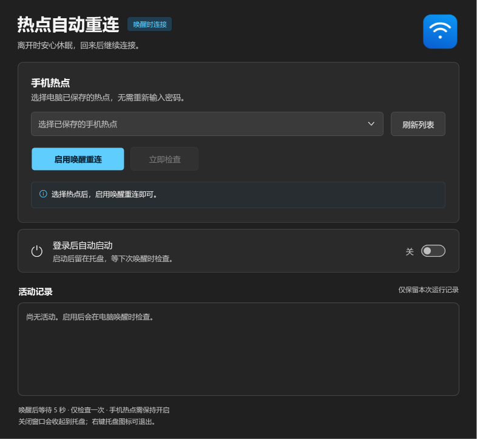
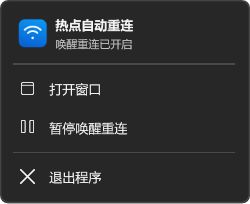

# Hotspot Reconnect

[简体中文](README.md) · [MIT License](LICENSE)

A small Windows utility that attempts to reconnect to a saved phone hotspot after sleep or hibernation. **One check per resume, with no polling and no continuous retries.**

## How it works

Enable resume reconnection for a saved Wi-Fi profile. After Windows resumes, the app waits five seconds, checks the selected adapter once, and requests one connection if it is disconnected. Existing connections and in-progress Windows connection attempts are left to the system.

The phone hotspot must already be enabled. The app cannot enable a phone's hotspot, reset a wireless adapter, or guarantee Internet access. You can request another check manually from the main window.

The main window and tray menu use native Windows 11 DWM Mica and follow the system app color mode, including while the main window is hidden. Older systems and restricted visual-effect settings use a solid fallback. Mica requires Windows 11 build 22621 or later.

## Get started

Download `HotspotReconnect-win.zip` from [Releases](https://github.com/NorthWolf8192/hotspot-reconnect/releases), extract it to a permanent location, and run `HotspotReconnect.exe`. Successful [Actions runs](https://github.com/NorthWolf8192/hotspot-reconnect/actions) also provide a Windows build artifact.

1. Connect to the hotspot once using Windows Wi-Fi settings.
2. Select the saved profile and enable resume reconnection in the app.
3. Optionally enable startup at sign-in. Keep the executable at the same path afterward.
4. Closing the window hides it to the tray. Use the tray menu to pause or exit.

The UI is currently in Simplified Chinese. It uses .NET Framework 4.8 / WPF supplied with Windows 11, with no Python or NuGet dependencies.

## Build and test

On Windows, using Windows PowerShell or PowerShell 7:

```powershell
.\build.ps1             # dist\HotspotReconnect.exe
.\test.ps1              # 9 headless-safe core assertions
.\test.ps1 -Desktop     # interactive desktop checks and layout previews
```

The complete desktop suite includes 39 assertions on a Mica-capable Windows 11 desktop. Native appearance assertions are conditional on OS support. Tests use simulated Wi-Fi and theme input; they do not modify system appearance or connect to real networks. Real hardware sleep/resume testing remains necessary.

GitHub Actions builds and tests pushes and pull requests. Publishing a GitHub Release builds and uploads a Windows ZIP asset to that release.

## Privacy

The app uses existing Windows profiles without reading Wi-Fi passwords or scanning nearby networks. There is no telemetry or data upload. Settings are local to `%LOCALAPPDATA%\HotspotReconnect\settings.xml`; logs exist only in memory. Startup registration is added to the current user's `Run` key only when requested in the UI.

## Screenshots

These are layout renders on solid fallback backgrounds. Windows renders the actual Mica material at runtime.





## License

The source and original icon assets are available under the [MIT License](LICENSE).
