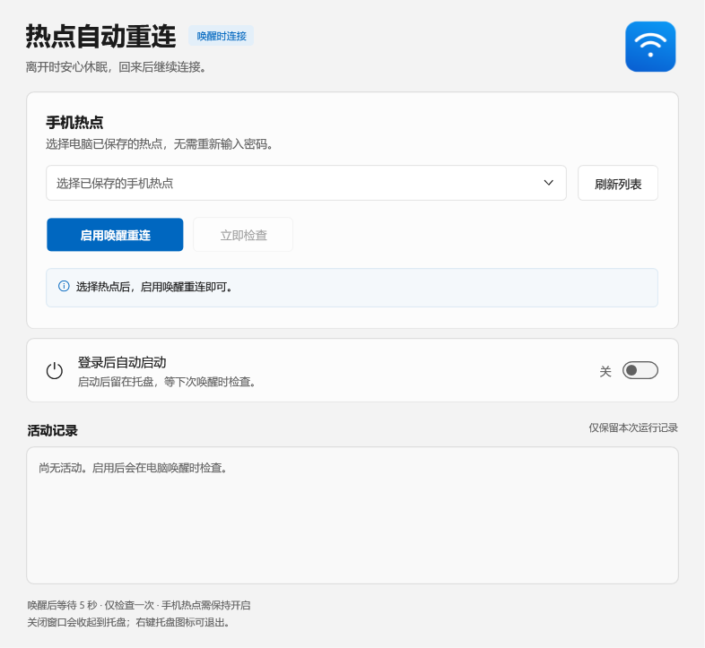
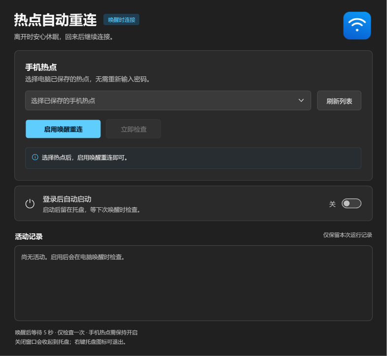
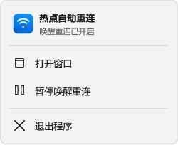
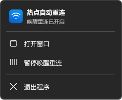

<p align="center"></p>

# Hotspot Reconnect · 热点唤醒重连

[English](README.en.md) · [完整使用说明](docs/USER_GUIDE.zh-CN.md) · [MIT License](LICENSE)

让 Windows 电脑在睡眠或休眠唤醒后，尝试重新连接已保存的手机热点。

**每次唤醒只检查一次，不定时轮询，不持续重试。** 界面采用 Windows 11 原生云母材质，主窗口与托盘菜单均跟随系统应用的深色 / 浅色模式。

## 功能

- 收到系统唤醒通知后等待 5 秒，再检查一次所选无线网卡；断开时只提交一次连接请求。
- 已连接其他 Wi-Fi，或 Windows 正在连接、验证时，交由系统继续处理。
- 从 Windows 已保存的 Wi-Fi 配置中选择热点，不读取或保存热点密码。
- 托盘常驻，可手动检查、暂停或启用唤醒重连，也可选择登录后自动启动。
- 主窗口和托盘菜单使用 DWM 原生 Mica；支持系统主题切换、高对比度、圆角及缩放。

## 下载和使用

在 [Releases](https://github.com/NorthWolf8192/hotspot-reconnect/releases) 下载 `HotspotReconnect-win.zip`，解压后运行 `HotspotReconnect.exe`。也可以从成功的 [Actions 构建](https://github.com/NorthWolf8192/hotspot-reconnect/actions) 下载构建产物，或按下方步骤自行编译。

1. 先在 Windows 中成功连接一次手机热点，让系统保存连接信息。
2. 打开程序，选择热点，点击“启用唤醒重连”。
3. 根据需要打开“登录后自动启动”。启用后请保持程序文件位置不变。
4. 关闭窗口会收起到托盘；右键托盘图标可暂停或退出。

手机回来时需保持热点开启。程序不能替手机开启热点，也不会自动重启无线网卡。“已请求连接”表示请求已交给 Windows，请在系统 Wi-Fi 菜单确认连接结果。

## 运行环境

- Windows 11，推荐 22H2 / 内部版本 22621 或更新版本以显示云母效果。
- 系统自带的 .NET Framework 4.8 / WPF，以及可用的无线网卡和 WLAN AutoConfig 服务。
- 较旧系统或系统关闭材质效果时，回退为同主题纯色背景。Windows 10 也使用纯色回退。
- 程序需在用户会话中运行。仅锁屏、开机登录或热点重新出现不会自动触发连接检查。

## 界面预览

以下为布局渲染图，使用纯色底图；实际云母背景由 Windows 桌面合成器渲染。

| 浅色 | 深色 |
| --- | --- |
|  |  |
|  |  |

## 从源码构建

在 Windows PowerShell 或 PowerShell 7 中运行：

```powershell
.\build.ps1
```

产物位于 `dist\HotspotReconnect.exe`。构建使用系统 .NET Framework C# 编译器，不需要下载 NuGet 包。界面和图标资源已嵌入可执行文件。

```powershell
# 不依赖交互桌面和真实 Wi-Fi 的核心检查，适用于 CI
.\test.ps1

# 需交互式 Windows 桌面的完整检查及布局预览
.\test.ps1 -Desktop
```

核心检查包含 9 项断言。完整桌面检查在支持 Mica 的 Windows 11 环境中包含 39 项断言；不支持原生深色属性时会跳过相应原生属性断言。检查不会修改系统主题、读取热点密码或操作真实 Wi-Fi。

GitHub Actions 会在推送和拉取请求时编译、执行核心检查并提供 Windows 压缩包。发布 GitHub Release 后，构建流程会把压缩包上传到该版本。

## 隐私与设置

- 不扫描附近 Wi-Fi，不读取、导出或保存密码，没有遥测或上传功能。
- 配置仅保存热点配置名称、网卡标识和启用状态，位于 `%LOCALAPPDATA%\HotspotReconnect\settings.xml`。
- 自动启动仅在主动打开开关时，写入当前用户的 Windows `Run` 项。
- 活动记录仅保留在本次运行的内存中。

## 已知限制

5 秒后网卡仍未就绪，或手机热点尚未可用时，本次检查结束，可手动点击“立即检查”。自动唤醒也可能触发检查。模拟测试不等同于真实手机离开及电脑睡眠唤醒的验证；无线驱动和手机省电设置可能影响连接效果。

## 参与开发

欢迎提交 Issue 或 Pull Request。报告连接问题时，请说明 Windows 版本、无线网卡型号以及程序提示；请勿上传热点密码或个人配置文件。

源码与原创图标均按 [MIT License](LICENSE) 发布。
